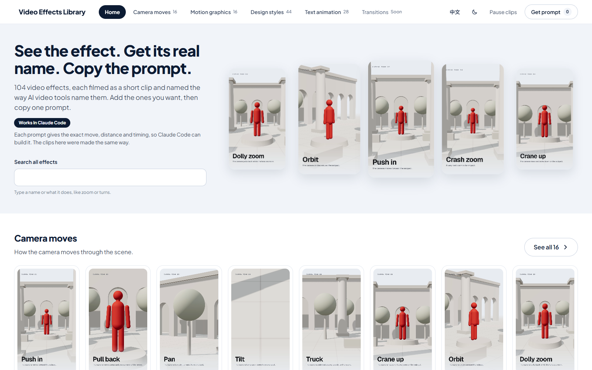
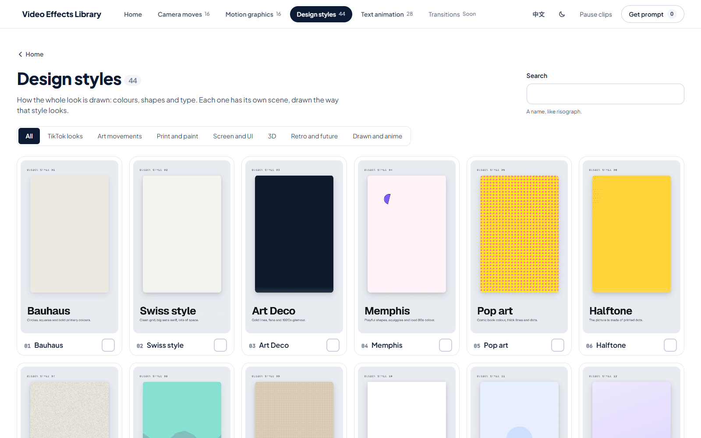
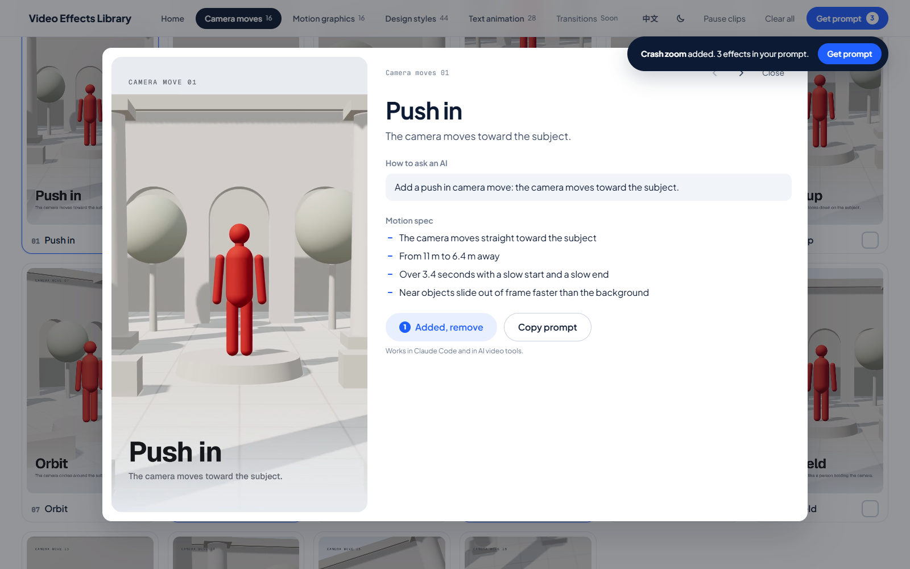
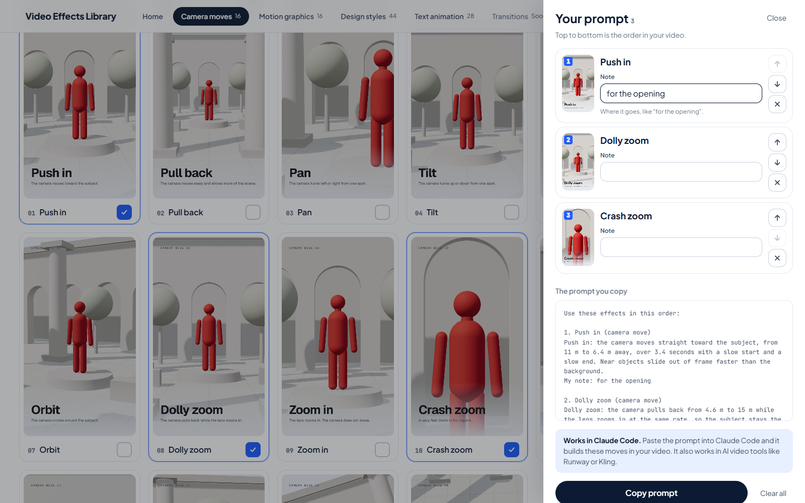
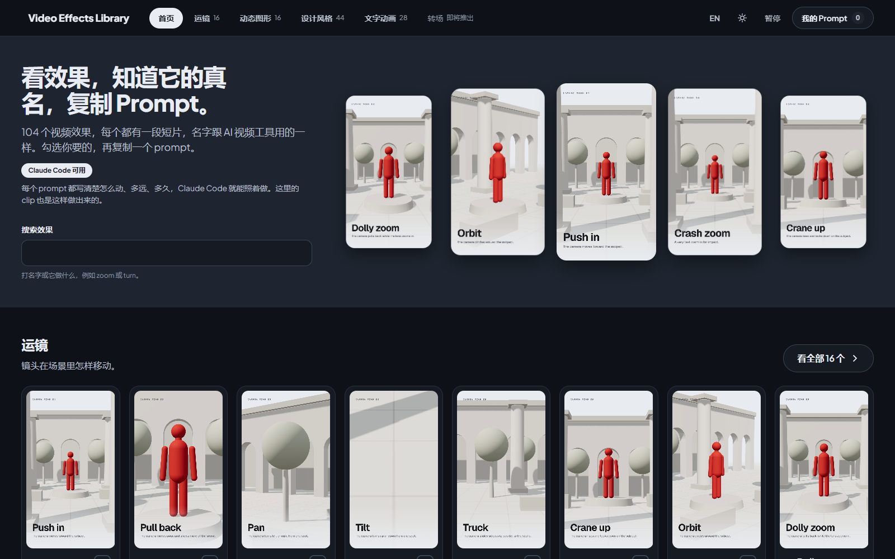

<p align="center">
  
</p>

<h1 align="center">Video Effects Library</h1>

<p align="center">
  104 named video effects, each shown as a short playing clip.<br>
  Tick the ones you want and copy one prompt for Claude Code or any AI video tool.
</p>

<p align="center">
  <a href="README.zh.md">中文说明</a> ·
  <a href="#use-it">Use it</a> ·
  <a href="#whats-inside">What's inside</a> ·
  <a href="#add-a-category">Add a category</a> ·
  <a href="#rebuild-the-clips">Rebuild the clips</a>
</p>

<p align="center">
  
  
  
</p>

---

## Why

People make videos with AI now, but most of us can't name the effect we want. "Make it cinematic" gets a random result. "Dolly zoom: the camera pulls back from 4.6 m to 15 m while the lens zooms in, over 3.4 seconds" gets the shot.

This library puts the real name on each effect, shows it moving, and gives you the exact words to ask for it.

## What's inside

| Category | Effects | What it covers |
|---|---|---|
| **Camera moves** | 16 | Push in, orbit, dolly zoom, whip pan, FPV fly-through and more, all filmed in the same 3D set so you can compare them |
| **Motion graphics** | 16 | Pop in, overshoot, stagger, mask reveal, count-up, motion trail and more |
| **Design styles** | 44 | Bauhaus, Swiss style, Risograph, Glassmorphism, Liquid metal, FUI, Frutiger Aero, Y2K and more, each drawn and moving in its own style |
| **Text animation** | 28 | Typewriter, scramble, highlighter, karaoke captions, 3D extruded text and more |

Every effect has:

- a **9:16 clip** made in code (no stock footage, no generated pictures)
- its **real name**, backed by source links in the data file
- **How to ask an AI**: one plain sentence
- a **motion spec**: the exact move, distance, timing and easing
- a **prompt** you can paste into Claude Code, Runway, Kling, Veo and other tools

<p align="center">
  
  
</p>

## Use it

No install and no server. Download the repo and open one file:

```bash
git clone https://github.com/ameng-nocode/video-effects-library.git
```

Then open `site/index.html` in your browser.

1. **Watch.** Every clip plays. Use the tabs and filters to find a category or a type of effect.
2. **Tick.** Tick the box under each effect you want. The **Get prompt** button counts them.
3. **Order and note.** Open **Get prompt**, move effects up or down, and add a note to each ("for the opening").
4. **Copy.** Press **Copy prompt** and paste it into your AI tool.

The copied prompt looks like this:

```text
Use these effects in this order:

1. Push in (camera move)
Push in: the camera moves straight toward the subject, from 11 m to 6.4 m away, over 3.4 seconds with a slow start and a slow end. Near objects slide out of frame faster than the background.
My note: for the opening

2. Dolly zoom (camera move)
Dolly zoom: the camera pulls back from 4.6 m to 15 m while the lens zooms in at the same rate, so the subject stays the same size and the background grows behind it, over 3.4 seconds with a slow start and a slow end.
```

The top bar has an **English / 中文** switch and a **light / dark** switch. Your picks, notes, language and theme are saved in your own browser.

<p align="center">
  
  
</p>

## How it works

```text
data/<category>.json        names, lines, prompts and sources for each effect
previews/clips/...          one 9:16 clip per effect (720 px wide, about 5 s)
site/categories.json        which categories the site shows, with their filter groups
site/build.mjs              reads the above and writes site/library.js
site/index.html             the site (plain HTML, CSS and JavaScript)
scripts/                    the code that builds every clip
```

The site reads only `site/library.js`, so it opens straight from disk. After you change any data, run:

```bash
node site/build.mjs
```

## Add a category

A new category needs three things and no site code:

1. **A data file** `data/<category>.json`: a list of effects, each with `id`, `no`, `name`, `line`, `prompt`, `also_called` (`[{ "name", "where" }]`) and `sources` (`[{ "name", "url" }]`).
2. **Clips** at `previews/clips/<category>/<id>.mp4`: 9:16, 720 px wide, about 5 seconds, with the effect name and one line at the bottom like the others.
3. **One entry** in `site/categories.json` with the title, one line, the data path, the clip folder and its filter groups. Add the Chinese title and filter names to `site/zh.json`.

Then run `node site/build.mjs`. "Transitions" is already in the list and shows as *Soon* until its data file exists.

## Rebuild the clips

You only need this to change a clip or make new ones. You need Node 20 or newer, [ffmpeg](https://ffmpeg.org/) and the [HyperFrames](https://github.com/heygen-com/hyperframes) renderer (run through `npx`, nothing to install by hand).

Each category has a scene builder and a render script:

| Category | Build the scenes | Render the clips |
|---|---|---|
| Camera moves | `node scripts/build-set3d.mjs` | `bash scripts/build-camera-render.sh <id>` |
| Motion graphics | `node scripts/build-mg.mjs` | `bash scripts/build-mg-render.sh <id>` |
| Design styles | `node scripts/build-ds.mjs` | `bash scripts/build-ds-render.sh <id>` |
| Text animation | `node scripts/build-text.mjs` | `bash scripts/build-text-render.sh <id>` |

Pass one or more effect ids, for example `push-in orbit`. Scenes use [Three.js](https://threejs.org/) for 3D and [GSAP](https://gsap.com/) on one paused timeline, so every frame renders the same way every time.

## Where the names come from

No name is made up. Each one is the word an AI video tool, an animation library or a design reference uses for that effect. Every effect lists its sources with links in `data/<category>.json`.

Camera move names come from the official guides of Runway, Google Veo, Kling, MiniMax Hailuo, Higgsfield, Luma and OpenAI Sora. Motion graphic and text names come from GSAP, Motion, Animate.css, After Effects and the HyperFrames registry. Design style names come from design history references and the style words people use in AI image and video tools.

The names belong to the tools and communities that use them; this project only links to them. The clips are original and made in code for this library.

## Credits

- [HyperFrames](https://github.com/heygen-com/hyperframes) (Apache-2.0) renders the clips.
- [Three.js](https://threejs.org/) (MIT) for the 3D scenes. The 3D text uses the Helvetiker typeface that ships with Three.js.
- [GSAP](https://gsap.com/) for timing and easing inside the scenes.
- [Geist and Geist Mono](https://vercel.com/font) (SIL Open Font License 1.1) for the labels in the clips.
- The site loads Plus Jakarta Sans and JetBrains Mono from [Google Fonts](https://fonts.google.com/) (SIL Open Font License 1.1).

## Contributing

New effects, better clips and new categories are welcome. See [CONTRIBUTING.md](CONTRIBUTING.md).

## Licence

[MIT](LICENSE). The code and the clips are free to use, change and share.
